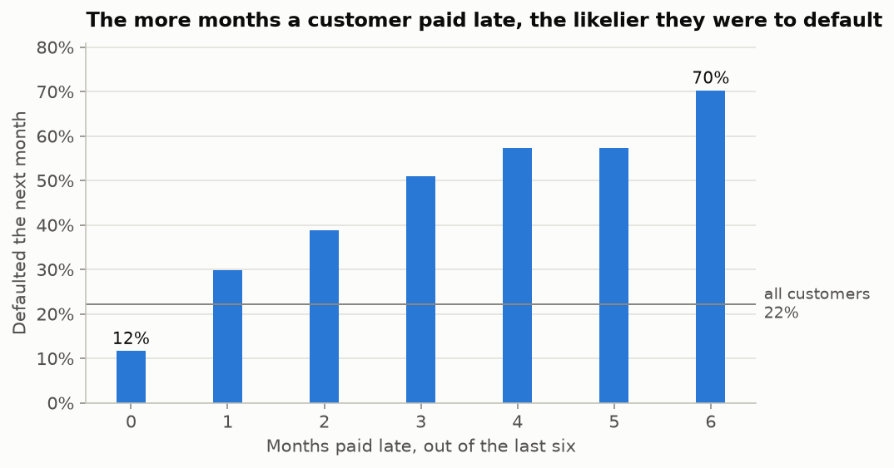
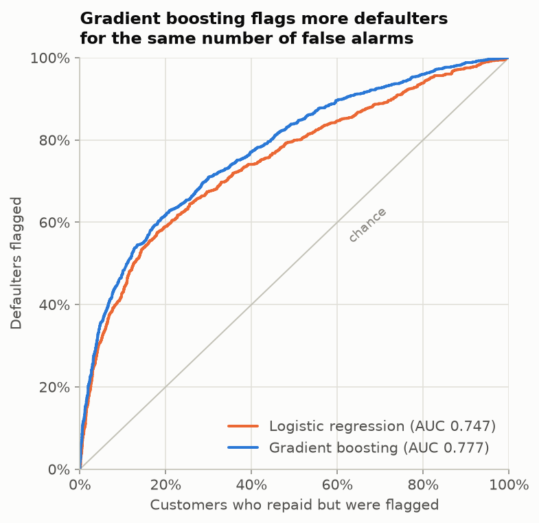
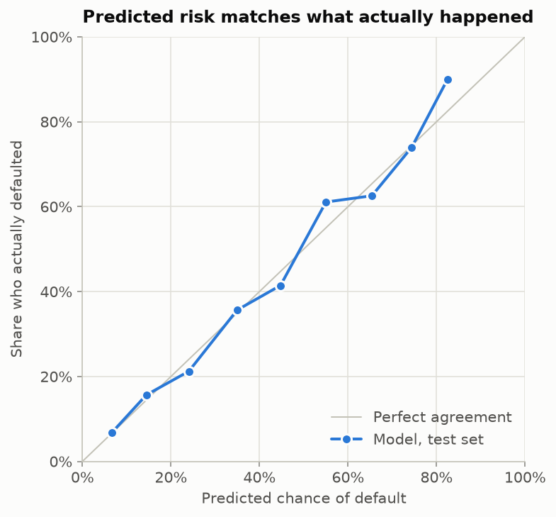
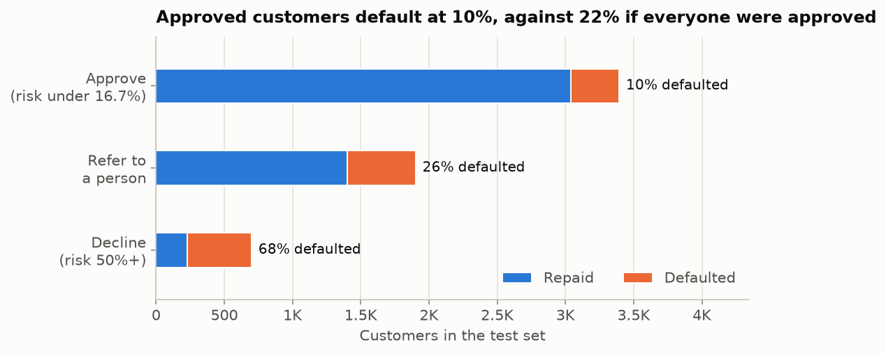
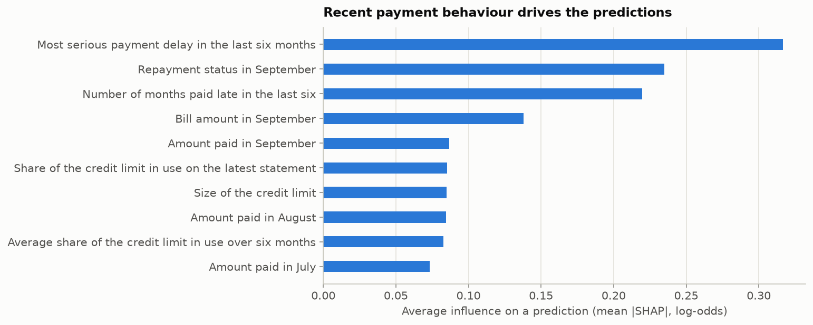
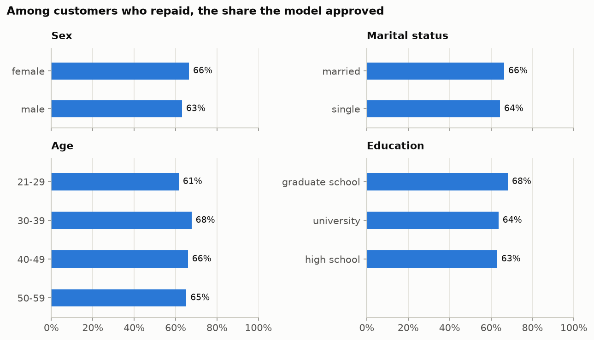

# CrediWise

**Predicting which credit card customers will miss next month's payment**, from
the six months of history a card issuer already holds, and turning that
prediction into a decision a lender can act on and explain.

Built on real data: 30,000 credit card customers of a Taiwanese bank in 2005
([UCI, Yeh 2009](https://doi.org/10.24432/C55S3H), CC BY 4.0).

**Start with the walkthrough:**
[`notebooks/walkthrough.ipynb`](notebooks/walkthrough.ipynb) tells the whole
story top to bottom, with charts, in about ten minutes of reading.

---

## The problem

A card issuer wants to know, before next month's statement, which customers are
likely to miss their payment. That lets it decide whether to keep extending
credit, for example to approve a limit increase, send the case to an analyst, or
decline, instead of finding out after the money is gone.

For each customer the model sees only how they have used their card: the credit
limit, and six months of bills, payments and repayment status. It never sees
sex, marital status, age or education.

## At a glance

All on a test set of 5,993 customers that played no part in building the model.

| | |
|---|---|
| **AUC** (how well it ranks risk; 0.5 = coin flip) | **0.777**, against 0.747 for a logistic-regression benchmark |
| Of the 10% it ranks riskiest | **69% defaulted**, against 22% overall |
| Approved customers who then default | **10.4%**, against 22.1% if everyone were approved |
| Customers who repaid but were declined | 4.8% |
| Predicted vs actual default rate | within **1.3 points** on average |
| Fairness | passes the four-fifths rule for sex, marital status, age and education |

Accuracy isn't quoted: 22% of customers default, so predicting "nobody
defaults" is already 78% accurate and useless. Every figure comes from
[`docs/MODEL_CARD.md`](docs/MODEL_CARD.md), and every chart below from
`make train`, so neither can drift from the model.

## Key findings

### 1. Late payments are the strongest warning sign

Customers who paid on time in all six months defaulted 12% of the time.
Those who were late in all six: 70%.

<picture>
  <source media="(prefers-color-scheme: dark)" srcset="docs/images/default-rate-by-lateness-dark.png">
  
</picture>

### 2. The model ranks risk well, and beats a simple benchmark

Gradient boosting (AUC 0.777) beats logistic regression (0.747) at every
trade-off between catching defaulters and wrongly flagging good customers. Of
the 10% of customers it ranks riskiest, 69% defaulted.

<picture>
  <source media="(prefers-color-scheme: dark)" srcset="docs/images/roc-dark.png">
  
</picture>

### 3. Its probabilities can be taken at face value

Grouped by predicted risk, the share who actually defaulted tracks the
prediction to within 1.3 points on average, so no extra calibration step is
needed. The highest bins hold few customers, so they wobble more.

<picture>
  <source media="(prefers-color-scheme: dark)" srcset="docs/images/calibration-dark.png">
  
</picture>

### 4. Its decisions halve defaults among approved customers

The policy approves 57% of customers, refers 32% to a person and declines 12%.
Approved customers default at 10% (against 22% if everyone were approved), and
68% of those declined did default. Only 4.8% of customers who repaid were
declined.

<picture>
  <source media="(prefers-color-scheme: dark)" srcset="docs/images/decisions-dark.png">
  
</picture>

### 5. Recent payment behaviour drives every prediction

The three biggest influences are all about lateness: the worst delay in six
months, the latest month's status, and how many months were late. The reasons
given for each decline come from the same calculation (SHAP), applied to that
one customer.

<picture>
  <source media="(prefers-color-scheme: dark)" srcset="docs/images/importance-dark.png">
  
</picture>

### 6. Fair across groups, with one to watch

The model never sees sex, marital status, age or education, so the audit checks
its outcomes instead. All four pass the four-fifths rule. The group to watch is
**customers aged 21–29**: the model predicts 23.6% will default when 21.7%
actually did, and creditworthy customers in that group are approved 61% of the
time against 68% for ages 30–39. A likely cause and the next step are in
[`docs/FAIRNESS.md`](docs/FAIRNESS.md).

<picture>
  <source media="(prefers-color-scheme: dark)" srcset="docs/images/fairness-dark.png">
  
</picture>

## How it works

1. **Clean the data.** Readable names, duplicates removed, undocumented codes
   labelled rather than guessed. See [`docs/DATA.md`](docs/DATA.md).
2. **Set aside a test set first.** Every choice is made on the other 80% with
   cross-validation; the test set is scored once, at the end.
3. **Choose a model.** Gradient boosting beat logistic regression clearly
   (cross-validated AUC 0.788 vs 0.756), and a search over 40 settings fine-tuned
   it.
4. **Turn risk into a decision.** If lending to a defaulter costs 5× a lost
   customer, approving pays while risk is under 1 in 6. So: approve below 16.7%,
   decline at 50% or more, refer the rest to a person.
5. **Explain every non-approval.** SHAP splits each prediction into the effect of
   each feature, giving plain-language reasons, as US lending rules require
   for a decline.
6. **Check fairness on outcomes.** Leaving sensitive columns out doesn't make a
   model fair, so approvals are compared across groups. See
   [`docs/FAIRNESS.md`](docs/FAIRNESS.md).

## Run it

```bash
make install    # dependencies
make train      # ~45 s: trains, scores the test set, writes the model card and charts
make test       # 42 tests
make serve      # web service on :8000, interactive docs at /docs
make notebook   # re-run the walkthrough
```

The dataset is included in `data/`. `make data` re-downloads it from UCI and
checks it against a known checksum.

Score a customer:

```bash
curl -X POST localhost:8000/score -H 'Content-Type: application/json' -d '{
  "credit_limit": 120000,
  "status_sep": -1, "status_aug": 2, "status_jul": 0, "status_jun": 0, "status_may": 0, "status_apr": 2,
  "bill_sep": 2682, "bill_aug": 1725, "bill_jul": 2682, "bill_jun": 3272, "bill_may": 3455, "bill_apr": 3261,
  "paid_sep": 0, "paid_aug": 1000, "paid_jul": 1000, "paid_jun": 1000, "paid_may": 0, "paid_apr": 2000
}'
```

```json
{
  "probability_of_default": 0.364,
  "decision": "refer",
  "reasons": [
    {"reason": "Most serious payment delay in the last six months", "contribution": 0.5985},
    {"reason": "Number of months paid late in the last six",        "contribution": 0.2446},
    {"reason": "Share of the latest bill that was paid",            "contribution": 0.1544},
    {"reason": "Amount paid in September",                          "contribution": 0.1087}
  ],
  "model_version": "sha256:…",
  "disclaimer": "Demonstration model trained on 2005 credit card data from one Taiwanese lender. Not validated for real lending decisions."
}
```

`model_version` is a hash of the model file, so every decision records which
model made it. Sending `sex`, `age`, `marital_status` or `education` is
rejected, so no client can believe the model uses them.

## What's where

| Path | Contents |
|---|---|
| `notebooks/walkthrough.ipynb` | The whole project as one readable story |
| `src/crediwise/` | The code: data, model, decisions, explanations, fairness, charts, web service |
| `tests/` | 42 tests |
| `docs/MODEL_CARD.md` | Every result, generated from the training run |
| `docs/images/` | The charts above, light and dark, generated from the training run |
| `docs/DATA.md` | Where the data comes from and how it was cleaned |
| `docs/FAIRNESS.md` | How fairness was checked, and what couldn't be |
| `docs/LESSONS_FROM_V1.md` | What the first version of this project got wrong |

## Limitations

- **One bank, one country, one year.** Nothing here shows the model would work
  for another lender, or today.
- **No test across time.** All customers come from the same six months, so how
  fast the model would go stale is unmeasured.
- **Two repayment codes are undocumented** (−2 and 0, the most common values).
  They're used as ordered codes without inventing a meaning.
- **The 5:1 cost ratio is illustrative.** A lender would use its own figures;
  the thresholds follow automatically.
- **Fairness can only be checked for what the data contains:** sex, marital
  status and age, not race, religion or national origin.

## Version 1

This project started as a notebook on a synthetic dataset, classifying people
into Poor / Standard / Good credit-score brackets. Auditing it found that its
headline accuracy was inflated by about ten points, and that the data itself
couldn't support real-world claims. Those lessons shaped this version:
[`docs/LESSONS_FROM_V1.md`](docs/LESSONS_FROM_V1.md). The original notebook is
kept in `notebooks/Credit_Score_original.ipynb` for reference.

## Licence

Code: MIT. Data: CC BY 4.0, Yeh, I. (2009), *Default of Credit Card Clients*,
UCI Machine Learning Repository, https://doi.org/10.24432/C55S3H.
